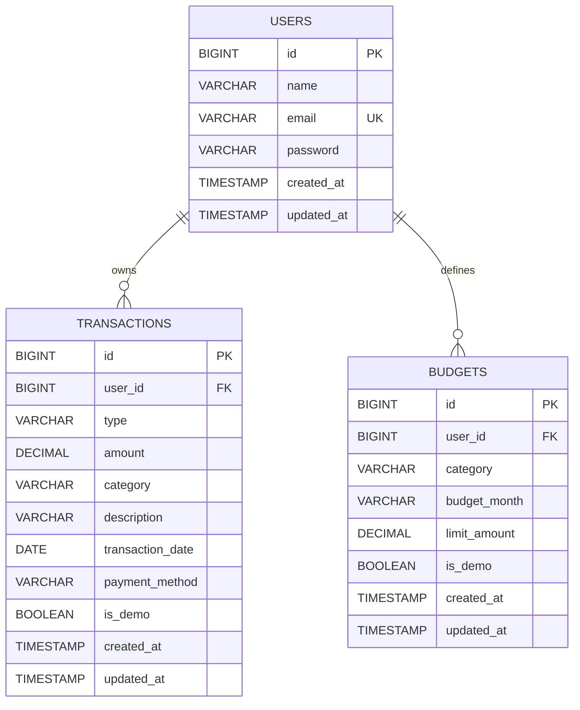

# ACADEMIC PROJECT REPORT: SPENDWISE — PERSONAL FINANCE TRACKER

**Course**: Server Side Engineering  
**Project Title**: SpendWise — Personal Finance Tracker  
**Tech Stack**: Java 21, Spring Boot 3.3.5, Spring Security 6.3, Spring Data JPA, Hibernate ORM, MySQL, HTML5, CSS3, Vanilla JavaScript, Chart.js  

---

## 1. ABSTRACT

Personal financial management is a crucial skill, particularly for college students who must budget allowances, stipends, and day-to-day expenditures on tight margins. Traditional spreadsheet applications lack responsiveness and automated validation, while commercial banking applications frequently miss cash transactions and cross-account categorical tracking.

**SpendWise** is a full-stack web application designed and developed for the subject *Server Side Engineering*. The application delivers a robust, multi-user, layered backend architecture built with Java 21, Spring Boot 3.3.5, Spring Security, Spring Data JPA, and MySQL. It features session-based authentication with BCrypt password hashing, complete user data isolation, exact monetary arithmetic using `java.math.BigDecimal`, dynamic query filtering through JPA Specifications, centralized exception handling with `@RestControllerAdvice`, and responsive Chart.js data visualizations bundled for offline execution. The frontend is built using semantic HTML5, modern CSS3, and vanilla JavaScript, adhering to human-centric editorial design principles without heavy third-party framework overhead.

---

## 2. INTRODUCTION & MOTIVATION

In modern web engineering, server-side frameworks must deliver predictable performance, strict data consistency, high cohesion, and secure input handling. Financial tracking applications represent a canonical domain for demonstrating server-side engineering principles:

1. **Transactional Integrity & Monetary Precision**: Financial amounts cannot tolerate rounding errors inherent in IEEE 754 floating-point numbers (`float` and `double`). `BigDecimal` with fixed scale and rounding modes is imperative.
2. **Authentication & User Data Isolation**: In multi-user applications, every query, mutation, and aggregation must be strictly scoped to the authenticated user. Ownership checks prevent horizontal privilege escalation.
3. **Database-Level Aggregation**: Computing income totals, categorical sums, and budget limits must occur via SQL aggregation queries on the relational engine rather than in-memory JavaScript processing.
4. **Data Normalization & Constraints**: Enforcing composite uniqueness (e.g. `(user_id, category, budget_month)`) ensures state validity before records reach the persistence layer.

---

## 3. OBJECTIVES & SCOPE

### Primary Objectives:
- Implement a three-tier enterprise architecture: Security Filter Chain, Presentation (REST Controllers), Business Logic (Services), and Persistence (Spring Data JPA Repositories).
- Establish session-based user authentication using Spring Security with BCrypt password hashing and CSRF protection.
- Ensure strict multi-user data isolation across all CRUD operations, summary cards, and analytical reports.
- Establish relational persistence with MySQL, ensuring ACID compliance and parameterized queries against SQL injection.
- Develop dynamic pagination, multi-column sorting, and keyword search using Spring Data Specifications.
- Provide budget tracking with dynamic utilization percentages and multi-threshold visual warnings (Normal, Warning, Exceeded).
- Deliver analytical reporting featuring month-over-month comparisons (absolute and percentage changes).
- Provide automated unit and integration tests (31 test cases) using JUnit 5, Spring Security Test, and Spring Boot Test with an embedded H2 test profile for offline build verification.

### Scope & Constraints:
- Full-stack self-hosted application with MySQL relational storage.
- Idempotent academic demo data seeder and selective demo clearing utility for college viva and project demonstrations.
- 100% offline-ready client bundle with local Chart.js assets.

---

## 4. SYSTEM ARCHITECTURE

SpendWise utilizes a layered Spring Boot architecture ensuring clear separation of concerns:

```
┌────────────────────────────────────────────────────────┐
│            Client Layer (Browser)                      │
│   Semantic HTML5 • CSS3 Editorial Theme • Vanilla JS   │
│   Chart.js Visualizations • Asynchronous Fetch API     │
└───────────────────────────┬────────────────────────────┘
                            │ JSON over HTTP + JSESSIONID + XSRF-TOKEN
                            ▼
┌────────────────────────────────────────────────────────┐
│            Security Layer (Spring Security 6)          │
│   SecurityFilterChain • SessionCreationPolicy         │
│   BCryptPasswordEncoder • CookieCsrfTokenRepository    │
└───────────────────────────┬────────────────────────────┘
                            │ Authenticated Principal
                            ▼
┌────────────────────────────────────────────────────────┐
│            Presentation Layer (Spring Web)             │
│   AuthController         •  TransactionController      │
│   DashboardController    •  BudgetController           │
│   ReportController       •  DemoDataController         │
│   GlobalExceptionHandler (@RestControllerAdvice)       │
└───────────────────────────┬────────────────────────────┘
                            │ DTOs (Request / Response) + User Entity
                            ▼
┌────────────────────────────────────────────────────────┐
│            Business Logic Layer (Services)             │
│   AuthService            •  TransactionService         │
│   BudgetService          •  DashboardService           │
│   ReportService          •  DemoDataService            │
└───────────────────────────┬────────────────────────────┘
                            │ JPA Domain Entities (User, Transaction, Budget)
                            ▼
┌────────────────────────────────────────────────────────┐
│            Persistence Layer (Spring Data JPA)         │
│   UserRepository         •  TransactionRepository      │
│   BudgetRepository       •  Hibernate ORM              │
└───────────────────────────┬────────────────────────────┘
                            │ Parameterized SQL Queries & Aggregations
                            ▼
┌────────────────────────────────────────────────────────┐
│            Relational Database Engine                  │
│   MySQL 8.x/9.x Database: finance_tracker              │
│   In-Memory H2 for Offline Test Profile               │
└────────────────────────────────────────────────────────┘
```

---

## 5. DATABASE DESIGN (ER DIAGRAM)



---

## 6. BACKEND ENGINEERING HIGHLIGHTS

### 6.1 Authentication & Password Security
- Passwords are encrypted using Spring Security's `BCryptPasswordEncoder` with salted hashes. Plaintext passwords are never stored in the database.
- Sessions are managed via standard HTTP `JSESSIONID` cookies, authenticated against Spring Security's `UserDetailsService`.
- Cross-Site Request Forgery (CSRF) protection is enabled using `CookieCsrfTokenRepository.withHttpOnlyFalse()` and validated via `X-XSRF-TOKEN` headers.

### 6.2 Horizontal Privilege & Data Isolation
- Every mutating and querying service method takes the authenticated `User` object as an argument.
- In `TransactionService` and `BudgetService`, lookup by ID enforces:
  ```java
  if (!entity.getUser().getId().equals(user.getId())) {
      throw new ResourceNotFoundException("Resource not found with id: " + id);
  }
  ```
  Returning `ResourceNotFoundException` (HTTP 404) rather than `403 Forbidden` prevents attackers from discovering the existence of other users' records.

### 6.3 Idempotent Demo Seeding & Selective Clearing
- The demo seeder checks `transactionRepository.countByUserAndIsDemoTrue(user) > 0`. If demo data is already loaded for the current user, subsequent clicks immediately return 0 without inserting duplicate records.
- Records seeded by the demo feature are marked with `is_demo = true`. When the user selects "Clear Demo Data Only", only records matching `is_demo = true` are deleted, completely safeguarding personal financial entries.

### 6.4 Exact Monetary Arithmetic
- Floating-point representations (`float` / `double`) introduce catastrophic precision loss in financial totals. SpendWise enforces:
  ```java
  BigDecimal allTimeIncome = transactionRepository.sumAmountByUserAndType(user, TransactionType.INCOME);
  BigDecimal allTimeExpenses = transactionRepository.sumAmountByUserAndType(user, TransactionType.EXPENSE);
  BigDecimal balance = allTimeIncome.subtract(allTimeExpenses);
  ```

---

## 7. FRONTEND REDESIGN & USER EXPERIENCE

1. **Editorial Design System**:
   - Palette: Warm stone `#F7F7F2` canvas, deep forest green `#276749`, terracotta `#B85C50`, warm amber `#C28A35`, and dark charcoal `#1A202C`.
   - Typography: Clean Inter system font stack with tabular numerals (`tabular-nums`) ensuring column decimal alignment.
2. **Sidebar Proportioning**:
   - Fixed 250px width, 24px top padding, 46px nav item heights with 10px gaps, 18px icons, and 12px label spacing.
   - Pinned bottom profile card displaying user initials avatar, full name, email, and prominent "Log out" button.
3. **Single Primary Action UI**:
   - Exactly one "Add Transaction" button is displayed on the dashboard (located in the top bar).
   - Removed the confusing duplicate button from the dashboard empty state banner.
4. **Modal Window Sizing & Scroll Locking**:
   - 620px max-width container, 16px corner radius, 24px header padding, 24px body padding with 20px form-group gaps, 46px input heights, and 2-column Date/Payment Method row.
   - Background scrolling is locked (`document.body.style.overflow = 'hidden'`) while any modal is open and restored on close.
   - Accessible dismissal via Escape key and backdrop click.

---

## 8. TESTING & QUALITY ASSURANCE

The automated test suite consists of **31 test cases** covering every tier of the application:

1. **Authentication Tests (`AuthServiceTest`)**:
   - User registration success and BCrypt hash verification.
   - Rejection of mismatched passwords.
   - Case-insensitive duplicate email rejection.
   - Retrieval of authenticated user from `SecurityContext`.
2. **Demo Data Tests (`DemoDataServiceTest`)**:
   - Seeding idempotency (repeated seed calls return 0 / no duplicate records).
   - Selective demo data clearing (demo records removed while personal records are preserved).
   - Total database reset.
3. **Transaction Tests (`TransactionServiceTest`)**:
   - CRUD lifecycle, amount validation (> 0), category filtering, pagination, and keyword search.
   - Strict user isolation on retrieval, update, and deletion.
4. **Budget Tests (`BudgetServiceTest`)**:
   - Creation and zero initial spending calculation.
   - Rejection of duplicate category/month budgets for the same user.
   - Multi-user allowance for identical category and month.
   - Accurate Normal, Warning (≥80%), and Exceeded (>100%) status transitions.
5. **Dashboard & Report Tests (`DashboardServiceTest`, `ReportServiceTest`)**:
   - Clean zero state calculations.
   - All-time balance and net savings arithmetic.
   - Month-over-month delta comparisons (absolute and percentage changes).
6. **Integration Tests (`TransactionControllerIntegrationTest`)**:
   - HTTP 401 Unauthorized verification on unauthenticated requests.
   - MockMvc authenticated CRUD flow with CSRF token validation.
   - Duplicate budget HTTP 409 Conflict response.
   - Demo data endpoints lifecycle.

---

## 9. CONCLUSION & FUTURE ENHANCEMENTS

SpendWise exemplifies sound server-side engineering practices: layered architecture, session security, multi-tenant isolation, decimal arithmetic precision, idempotent operations, and accessible human-centered frontend design.

Future enhancements may include:
1. Automated email notifications for budget exceeded alerts.
2. Direct PDF export of monthly statements using iText or OpenPDF.
3. Multi-currency support with real-time exchange rate conversion.
